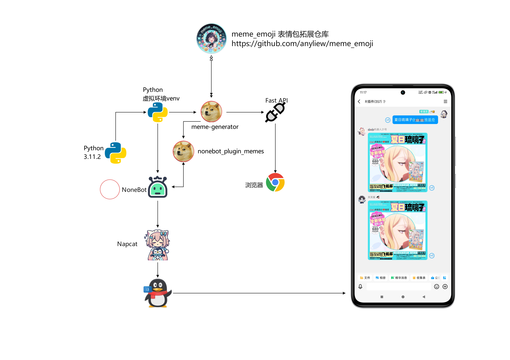

<div align="center">


**基于 [meme-generator](https://github.com/MemeCrafters/meme-generator) 的表情包扩展仓库**

为你的聊天机器人添加更多趣味表情生成

[](https://github.com/anyliew/meme_emoji/stargazers)
[](https://github.com/anyliew/meme_emoji/network/members)
[](https://github.com/anyliew/meme_emoji/issues)
[](./LICENSE)
[](https://www.python.org/)
[](https://github.com/MemeCrafters/meme-generator)

[表情列表](https://github.com/anyliew/meme_emoji/wiki/emoji_list) ·
[使用文档](https://github.com/anyliew/meme_emoji/wiki) ·
[问题反馈](https://github.com/anyliew/meme_emoji/issues) ·
[素材投稿](https://github.com/anyliew/meme_emoji/issues/new?template=feature.yml)

</div>



> [!TIP]
> 部分偏「整活」向的表情已迁移至姐妹仓库 [**crazy_emoji**](https://github.com/anyliew/crazy_emoji)

---

## ✨ 特性

| 特性 | 说明 |
| --- | --- |
| ✅ **海量表情** | 当前收录 **430+** 个表情，热门梗持续跟进，欢迎投稿高清素材 |
| ⚡ **实时生成** | 通过指令即时出图，支持图片、文字、可选参数组合 |
| 🔄 **即插即用** | 只需在 `meme_dirs` 中追加本仓库路径，无需改动上游代码 |
| 🎨 **纯素材仓库** | 所有表情以独立目录形式存在，新增/删除表情不影响其他内容 |
| 🤖 **自动维护** | GitHub Actions 自动重建表情列表与关键词索引，无需手动同步文档 |

## 📦 兼容性

> [!WARNING]
> **本仓库为 Python 版扩展，不支持 Rust 版 meme-generator。**
> 使用 Rust 版的用户请移步 [**meme-emoji**](https://github.com/anyliew/meme-emoji)（镜像移植仓库）。

本仓库的表情代码基于 `meme_generator` 的 Python API 编写，仅支持以下版本：

| 依赖库 | 最高兼容版本 | 说明 |
| --- | --- | --- |
| `meme_generator` | `0.1.14` | 0.2.0 起为 Rust 版 Python Binding，API 不兼容 |
| `nonebot-plugin-memes` | `0.7.12` | 依赖上述 `meme_generator` 版本 |

为确保功能正常运行，请勿使用高于上述版本的依赖库。若已安装更高版本，建议降级：

```bash
# 通用 /meme-generator 直接使用
pip install "meme_generator==0.1.14"

# NoneBot 用户（插件与内核需同时降级）
pip install "nonebot-plugin-memes==0.7.12" "meme_generator==0.1.14"
```

NoneBot 用户还需要在 NoneBot 项目根目录的 `pyproject.toml` 中启用插件：

```toml
[tool.nonebot]
plugins = ["nonebot_plugin_memes"]
```

更详细的环境要求与排查方式见 [版本兼容说明](https://github.com/anyliew/meme_emoji/wiki/Compatibility)。

## 🚀 快速开始

三步即可在本地跑起来：

1. **安装内核**：`pip install "meme_generator==0.1.14"`
2. **拉取本仓库**：`git clone https://github.com/anyliew/meme_emoji`
3. **挂载表情目录**：在 `config.toml` 中把 `meme_dirs` 指向本仓库的 `emoji` 目录

```toml
# Windows: C:\Users\<用户名>\AppData\Roaming\meme_generator\config.toml
# Linux:   ~/.config/meme_generator/config.toml
[meme]
load_builtin_memes = true                    # 是否同时加载内核内置表情
meme_dirs = ["/opt/meme_emoji/emoji"]        # 本仓库表情目录（填绝对路径）
```

| 场景 | 教程 |
| --- | --- |
| 🐧 Linux 服务器部署 | [Install-Linux](https://github.com/anyliew/meme_emoji/wiki/Install-Linux) |
| 🪟 Windows 本机部署 | [Install-Windows](https://github.com/anyliew/meme_emoji/wiki/Install-Windows) |
| 🐳 Docker 容器部署 | [Install-Docker](https://github.com/anyliew/meme_emoji/wiki/Install-Docker) |
| ⚙️ 配置文件详解 | [Configuration](https://github.com/anyliew/meme_emoji/wiki/Configuration) |
| 💻 命令行制作表情 | [Usage-CLI](https://github.com/anyliew/meme_emoji/wiki/Usage-CLI) |
| 🤖 接入聊天机器人 | [Usage-Bot](https://github.com/anyliew/meme_emoji/wiki/Usage-Bot) |
| ❓ 常见问题 | [FAQ](https://github.com/anyliew/meme_emoji/wiki/FAQ) |

## 🤠 表情示例

<details>
<summary>🖼 点击展开效果预览（"狗耳帽"）</summary>

<br />


</details>

### 😀 表情列表

| 排序方式 | 说明 | 链接 |
| --- | --- | --- |
| 😉 名称排序 A-Z | 按表情 `key` 排列，附关键词与参数说明 | [emoji_list](https://github.com/anyliew/meme_emoji/wiki/emoji_list) |
| 🥰 时间排序 新-旧 | 按上线日期倒序，附预览缩略图 | [emoji_keywords](https://github.com/anyliew/meme_emoji/wiki/emoji_keywords) |

## 📖 文档

完整文档托管在 Wiki：

- 📘 [meme_emoji Wiki 首页](https://github.com/anyliew/meme_emoji/wiki)
- 📗 [meme-generator 上游文档](https://github.com/MemeCrafters/meme-generator/wiki)

## 🤝 投稿与反馈

### 🥳 投稿素材

> 🚧 欢迎投稿高清素材，看到有趣的素材会制作成表情更新到本仓库！
>
> 通过 Issues 中的「投稿素材」模板提交；若能直接提 PR 则更好 🎉

投稿前建议先读一下 [新表情编写指北](https://github.com/MemeCrafters/meme-generator/wiki/%E6%96%B0%E8%A1%A8%E6%83%85%E7%BC%96%E5%86%99%E6%8C%87%E5%8C%97)，
并确认表情目录结构与命名符合本仓库约定。

### 🤔 问题反馈

> 提交地址：<https://github.com/anyliew/meme_emoji/issues>

- 单个表情异常请附带**完整报错日志**与**复现截图**
- 请说明运行环境（系统、Python 版本、`meme_generator` 版本）
- 受网络条件限制，答复可能不够及时，请耐心等待

## 💖 致谢

感谢以下开源项目及作者的贡献：

| 项目 | 说明 |
| --- | --- |
| [meme-generator](https://github.com/MemeCrafters/meme-generator) | 表情包生成器内核 |
| [one-last-image](https://github.com/itorr/one-last-image) | 表情「卢浮宫」素材来源 |
| [IdhagnBot](https://github.com/su226/IdhagnBot) | 表情「卢浮宫」代码参考 |

## ⚖ 许可

本项目沿用上游 [meme-generator](https://github.com/MemeCrafters/meme-generator) 作者 MeetWq 的 **MIT License**。

- 本仓库许可证全文：[LICENSE](./LICENSE)
- 上游许可证全文：[MemeCrafters/meme-generator/LICENSE](https://github.com/MemeCrafters/meme-generator/blob/main/LICENSE)

## 🔗 相关链接

| 类别 | 项目 | 说明 |
| --- | --- | --- |
| 🧩 上游内核 | [MemeCrafters/meme-generator](https://github.com/MemeCrafters/meme-generator) | 本仓库依赖的表情包生成器 |
| 📖 上游文档 | [meme-generator Wiki](https://github.com/MemeCrafters/meme-generator/wiki) | 安装、配置、API、新表情编写 |
| 📘 本仓库文档 | [meme_emoji Wiki](https://github.com/anyliew/meme_emoji/wiki) | 本仓库部署与使用教程 |
| 🦀 Rust 版本 | [anyliew/meme-emoji](https://github.com/anyliew/meme-emoji) | 本仓库表情的 Rust 镜像移植版 |
| 🦀 Rust 内核 | [MemeCrafters/meme-generator-rs](https://github.com/MemeCrafters/meme-generator-rs) | Rust 版表情包生成器 |
| 🎭 姐妹仓库 | [anyliew/crazy_emoji](https://github.com/anyliew/crazy_emoji) | 部分整活向表情迁移至此 |
| 🤖 NoneBot 插件 | [nonebot-plugin-memes](https://github.com/MemeCrafters/nonebot-plugin-memes) | NoneBot2 表情包制作插件 |
| 🌐 NoneBot API 版 | [nonebot-plugin-memes-api](https://github.com/MemeCrafters/nonebot-plugin-memes-api) | 调用 HTTP API 的轻量版本 |
| 🐱 Yunzai 插件 | [ikechan8370/yunzai-meme](https://github.com/ikechan8370/yunzai-meme) | Yunzai-Bot 表情包插件 |
| 🎛 Koishi 插件 | [lgc2333/koishi-plugin-memes-api](https://github.com/lgc2333/koishi-plugin-memes-api) | Koishi 表情包制作插件（API 版） |

## ⭐ 支持本项目

如果本项目对你有帮助，欢迎点亮一颗 ⭐ Star —— 你的鼓励是持续更新的动力。

<a href="https://github.com/anyliew/meme_emoji/stargazers">
  
</a>

## 💬 免责声明

- 本项目仅供学习与交流使用，禁止用于任何商业用途及违法用途
- 项目中的图片等资源均来自互联网，如有侵权请及时联系开发者，我们会尽快删除相关内容

---

## 贡献者 ✨

感谢这些了不起的人（[emoji-key](https://allcontributors.org/emoji-key/#natural-language-processing)）：

<!-- ALL-CONTRIBUTORS-LIST:START - Do not remove or modify this section -->
<!-- prettier-ignore-start -->
<!-- markdownlint-disable -->
<table>
  <tbody>
    <tr>
      <td align="center" valign="top" width="14.28%"><a href="https://wangkailing151.com/"><br /><sub><b>Loping151</b></sub></a><br /><a href="https://github.com/anyliew/meme_emoji/commits?author=Loping151" title="Code">💻</a></td>
      <td align="center" valign="top" width="14.28%"><a href="https://github.com/LRZ9712"><br /><sub><b>tudou</b></sub></a><br /><a href="https://github.com/anyliew/meme_emoji/commits?author=LRZ9712" title="Code">💻</a></td>
      <td align="center" valign="top" width="14.28%"><a href="https://github.com/xinghuan22"><br /><sub><b>xinghuan22</b></sub></a><br /><a href="https://github.com/anyliew/meme_emoji/commits?author=xinghuan22" title="Code">💻</a></td>
      <td align="center" valign="top" width="14.28%"><a href="https://github.com/MoonShadow1976"><br /><sub><b>MoonShadow1976</b></sub></a><br /><a href="https://github.com/anyliew/meme_emoji/issues?q=author%3AMoonShadow1976" title="Bug reports">🐛</a></td>
      <td align="center" valign="top" width="14.28%"><a href="https://github.com/KaedeharaLu"><br /><sub><b>KaedeharaLu</b></sub></a><br /><a href="https://github.com/anyliew/meme_emoji/commits?author=KaedeharaLu" title="Code">💻</a></td>
      <td align="center" valign="top" width="14.28%"><a href="https://github.com/AsadaFutaba"><br /><sub><b>AsadaFutaba</b></sub></a><br /><a href="https://github.com/anyliew/meme_emoji/commits?author=AsadaFutaba" title="Code">💻</a></td>
      <td align="center" valign="top" width="14.28%"><a href="https://github.com/xiih"><br /><sub><b>xiih</b></sub></a><br /><a href="https://github.com/anyliew/meme_emoji/commits?author=xiih" title="Code">💻</a></td>
    </tr>
  </tbody>
</table>
<!-- markdownlint-restore -->
<!-- prettier-ignore-end -->
<!-- ALL-CONTRIBUTORS-LIST:END -->

本项目遵循 [all-contributors](https://github.com/all-contributors/all-contributors) 规范。
